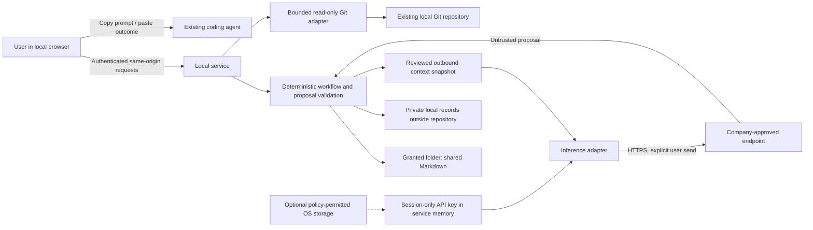

# Recommended local architecture

Status: target design, initially 2026-09-22, updated 2026-09-23. A read-only first slice now exists; see [codebase](../codebase.md) for actual behavior. Reviewed writes, durable history, full task state and project inference below remain future contracts.

## Runtime and stack

Use a React/TypeScript browser UI built with Vite, served by one Node.js process using Fastify. The slice is tested on installed Node 22.21.0; Node 24 remains a deployment candidate. Keep a small typed domain core free of filesystem, HTTP and provider dependencies. Use fixed application-owned schemas at every boundary. No agent framework, workflow engine, queue server, database server, containers, embeddings, or vector store.

Node 24 is listed as LTS in the official [release schedule](https://nodejs.org/en/about/previous-releases), checked 2026-09-22. React documents [Vite as a from-scratch build option](https://react.dev/learn/build-a-react-app-from-scratch). This local tool does not need server rendering, hosted routing, or search-engine optimization. Pin compatible patch/dependency versions at implementation time.

| Choice | Benefit | Cost or alternative |
| --- | --- | --- |
| TypeScript end to end | Shared types, one toolchain and straightforward browser work for one developer. | Qualify Windows filesystem semantics; an optional future OS credential adapter may need a maintained native binding. |
| React + Vite | Clear forms, evidence tables and diffs; static production UI. | More frontend dependencies than server-rendered HTML; keep state local to screens and avoid a large state framework. |
| Fastify + fixed JSON schemas | Small HTTP boundary with request validation and response field filtering. | Validation is not authorization; domain checks remain explicit. |
| Markdown shared state + private JSON | Git-friendly, no database migration or native SQLite dependency in the first release. | Constrained Markdown parsing, conflicts, and file recovery need careful engineering. |
| Source installation | Few packaging components; suits technical professionals. | Requires approved Node/npm and dependency access; less convenient than a signed installer. |
| Existing system browser | No bundled Chromium runtime. | A local service still needs authentication, path controls and lifecycle management. |

Spring Boot would suit the Java audience but adds a JDK and a second application language if using a rich browser UI. Go could simplify executable distribution but adds a second language and build/credential integration work. Tauri or Electron would improve native launch/folder UX but add a desktop release pipeline before the core workflow is proven. Revisit packaging after the Windows spike; familiarity with the user's training language alone should not determine the product stack.

Use application-owned JSON Schema definitions with TypeScript types generated or inferred from the same definitions. Fastify warns that schemas are compiled as code; never compile a schema supplied by a repository or model. See [validation documentation](https://fastify.dev/docs/latest/Reference/Validation-and-Serialization/). A Markdown parser should preserve source spans, not render and reserialize whole documents. Choose the parsing library during the spike. The core credential path needs no OS-vault library; evaluate an optional binding only if persistent storage is later included.

## Components and data flow

The coding agent is external. The app cannot observe its chats or execution. Its agent-provider configuration may differ from this app's approved endpoint. The user controls that separate exchange.

| Module | Responsibility | Must not do |
| --- | --- | --- |
| UI | Worksheets, scope review, outbound preview, copy/export, evidence labels, diff review. | Hold persistent credentials, authorize backend actions by hiding buttons. |
| Workflow core | Legal transitions, task dependencies, completeness rules, budgets, proposal types. | Perform network calls or trust model-requested transitions. |
| Workspace adapter | Granted paths, bounded reads, parsing, conflict detection and document writes. | Edit arbitrary code, follow repository instructions as policy. |
| Local Git adapter | Observe repository root, branch, HEAD, status and selected bounded diffs. | Fetch, clone, checkout, commit, push, invoke external diff filters or hosting APIs. |
| Private store | Session drafts, source provenance, evidence blobs and write-recovery records. | Become authoritative for shared tasks or project facts. |
| Inference adapter | Send one approved context snapshot and normalize a response. | Select additional files, run tools, follow URLs in model output. |
| Credential adapter | Acquire and clear a session-only endpoint key; optionally remember/retrieve it through a policy-permitted adapter. | Require OS storage, silently persist a key, return it in a normal settings response or log it. |

One active workflow turn, one outstanding provider request, and one writer per canonical workspace. Concurrent browser tabs use revision tokens; a second local process must detect the workspace lock and offer read-only mode. No background autonomous runs. A refresh or restart recovers a private draft, never silently resends a billable request.

## Deterministic orchestration

For the detailed strategy on selective code context, between-handoff changes, phase roll-ups and possible hosted/Git-assistant extensions, see [repository awareness and distribution](repository-awareness-and-distribution.md). These extensions do not change the current no-hosted-backend/no-Git-mutation boundary. The initial freshness check covers foundational document bytes and Git metadata only.

The explicit steps are clarify → plan → prepare → capture → reconcile → resume. Each has a private draft, validated proposal, and user review checkpoint. The UI can revisit earlier steps without discarding accepted evidence.

These are domain stages, not a mandatory teaching wizard. A seasoned AI engineer can open an existing task directly, reuse accepted context, inspect evidence, or prepare a handoff without repeating onboarding. Show explanations and question prompts when needed or requested. Require missing consequential information and the same review/permission guards in every entry path; do not create a separate expert mode that bypasses them.

| Deterministic application behavior | Optional LLM work |
| --- | --- |
| Load, save drafts, validate paths and Markdown, render exact diffs. | Identify ambiguity in a pasted assignment and suggest targeted questions. |
| Enforce task IDs, dependency graph, transition guards and provenance labels. | Interpret story intent and suggest bounded tasks/acceptance criteria. |
| Select and hash outbound context; enforce bytes/tokens/budget limits. | Synthesize relevant context into investigation/implementation drafts. |
| Render a next-session prompt from an accepted handoff. | Suggest debugging hypotheses, explicitly labeled as hypotheses. |
| Detect changed HEAD, working tree and document hashes. | Compare reported outcomes with selected evidence and suggest knowledge changes. |
| Validate/approve/apply document proposals; record approval and omitted checks. | Recommend the next task and explain trade-offs. |
| Build a debugging packet from required fields and selected attachments. | Ask which missing evidence would most reduce uncertainty. |

No model is required to copy a prompt, prepare a handoff from saved fields, reopen a project, or save a user edit. Model calls have a typed result such as `ClarificationProposal`, `TaskPlanProposal`, `HandoffDraft` or `KnowledgeProposal`. The model never returns executable filesystem instructions. Unknown task IDs, invalid paths, fabricated evidence IDs, unsupported fields, oversized output, or illegal state changes are rejected. Refusals and malformed output become recoverable UI errors; they do not mutate shared state.

Avoid automatic repair loops in v1. The user can edit the draft or explicitly retry with a new preview and budget estimate. A disconnected endpoint preserves work and exposes deterministic templates.

## Provider boundary

Implement one explicit text Chat Completions protocol profile first. A private profile contains base HTTPS URL, fixed relative inference route, opaque model/deployment identifier, key scheme (`Authorization: Bearer` or `api-key`), request/output limits, timeout, optional non-secret protocol version, and price estimates. Do not provide arbitrary header scripting, arbitrary credential commands, or repository-defined adapters. Reserve a typed `CredentialProvider` interface so keyless authentication can be added later.

The [official Chat Completions API](https://developers.openai.com/api/reference/resources/chat/subresources/completions/methods/create) is a reference dialect, not proof that every “compatible” gateway behaves identically. Qualify the real endpoint with a synthetic, non-project prompt: role handling, output-limit parameter, JSON result handling, cancellation, usage fields, and error shapes. Keep a small explicit capability profile rather than sending unsupported optional fields or guessing fallbacks. Use plain text plus a validated JSON response contract when provider-enforced structured output is unavailable. No tools, remote retrieval, provider-hosted conversation history, or file-upload APIs.

Connection test and generation are explicit network actions. No remote model listing is necessary; the user enters the approved identifier. Display the effective host and model before sending. A 401/403 prompts credential/access correction, 429 shows retry timing, 5xx or timeout offers a manual retry, TLS errors require fixing trust configuration. Do not disable certificate validation. After an ambiguous timeout, tell the user the provider may have processed the request; do not claim exactly-once billing or silently retry.

## Local-service security

Threats in scope: hostile websites reaching localhost, untrusted repositories/logs, accidental broad file access, leaked secrets/context, stale writes, unsafe Git helpers, malformed or oversized inputs, and another OS user accessing state. Same-user malware, administrator compromise, malicious browser extensions and arbitrary external writers are outside a local app's complete control; this is not a sandbox or full security audit.

**Service and browser.** Bind only to `127.0.0.1` on an OS-assigned port; no LAN listener or reverse proxy mode. Accept only the exact expected Host value; ignore forwarded-host headers. Launch with a random, single-use bootstrap token in the URL fragment (two-minute lifetime). The UI removes the fragment, exchanges it using POST, and holds an eight-hour, process-scoped session capability. Authenticate every content API, including reads. Implementation decision: preserve this capability in tab-scoped `sessionStorage` so browser refresh can restore service-held drafts; remove it on lock/401. Never store endpoint keys or project content there. This increases exposure to same-origin script compromise compared with memory-only storage; strict CSP, no remote scripts and text-only document rendering reduce that exposure. It does not create an anonymous localhost session or survive a service restart. If storage is blocked, pairing falls back to memory and refresh requires the launcher. Only explicit no-open/launch-failure mode prints a temporary local pairing instruction; HTTP logging stays off.

Require a custom authorization header, JSON content type and exact Origin on mutations, reject null/foreign origins and cross-origin preflights, and enforce same-origin fetch metadata where supplied. Read routes require authorization and reject foreign origins; lack of Origin on a same-origin GET alone is not sufficient to reject a legitimate read. No state-changing GET. CORS denial is only one control. This follows the defense-in-depth approach in [OWASP's CSRF guidance](https://cheatsheetseries.owasp.org/cheatsheets/Cross-Site_Request_Forgery_Prevention_Cheat_Sheet.html).

Serve bundled assets only, a restrictive CSP (`default-src 'self'`, no remote scripts/images, no objects or framing), no inline script requirement, `nosniff`, `Referrer-Policy: no-referrer`, and `Cache-Control: no-store` for sensitive API/preview responses. Render Markdown without raw HTML and without remote resource loading. Do not register a service worker. Opening an external link requires an explicit user action and does not let the backend fetch it. Production runs the built UI, not the Vite development server.

**Folder grants.** The launcher accepts one explicit path, or the authenticated UI opens a typed/pasted local path and shows its resolved location before granting access. The browser alone cannot safely provide the backend with arbitrary filesystem access through an upload picker. Start at the selected root; no whole-disk browsing or indexing. Store the canonical root in private settings, never in shared Markdown. Create/open initially authorizes bounded metadata and context-file reads; reading code/log contents requires explicit file selection. Show read-only mode on permission failure; never request administrator elevation as a routine fix.

The primary setup path is now the UI: Open project, Inference settings and Repository status, as specified in [UI experience](ui-experience.md). A launcher path argument is optional. Prefer a narrow native folder-dialog bridge after Windows qualification, with type/paste-path available in the UI when that bridge is blocked. Git association means observing the already-local folder; it introduces no hosting account connection or remote Git authentication. Apply the same authenticated request, path-grant and review rules to all UI entry points.

Canonicalize root and candidates; compare path segments with Windows case rules. Reject traversal, drive-relative paths, UNC/device namespaces, alternate data streams, reserved device names, links/junctions/reparse points inside the grant, and multiply-linked write targets. Validate parent directories and file identity again immediately before writes. Write only adopted context files and task handoffs; never `.git`, source files, executable files, or arbitrary model-provided paths. Files imported from elsewhere use an explicit one-file grant copied into private storage. Limit size/count before reading; refuse binary files in text selection. Network shares and cloud-synchronized folders are not qualified MVP write targets.

Support ordinary repositories, detached HEAD, no-commit repositories, and Git worktrees. External Git metadata referenced by a worktree `.git` file needs a separately disclosed read-only metadata grant; this does not grant access to other source folders. Validate that the selected folder belongs to the reported worktree, and do not silently expand the workspace to a parent repository. Submodules are shown as opaque entries; opening one is a separate workspace action. Git hosting URLs do not affect local behavior.

**Git execution.** Use only a packaged allowlist of read operations, an explicitly located trusted Git executable, direct argument arrays, a minimal environment, no shell, no pager, bounded time/output, disabled optional index locks and filesystem-monitor hooks. For diffs disable external helpers and text conversion; Git documents both switches in [git-diff](https://git-scm.com/docs/git-diff). Clear inherited Git execution/environment overrides, pass path operands after `--`, and qualify unusual repository configuration in hostile-fixture tests. Never run project hooks, builds, package managers, test commands or a model-suggested command. If a safe inspection cannot be established, show Git metadata unavailable while retaining the manual workflow.

**Credentials.** API-key authentication does not require Windows Credential Manager. The default MVP path accepts a key through the authenticated local UI and holds it only in service memory for the running session. No native vault access, persistence permission, or administrator action is needed for this path. It remains subject to the company's rules for supplying endpoint credentials; it is not a workaround for a policy that prohibits manual key entry itself.

Offer an explicit Clear key / lock action that cancels active requests and drops the application's key reference. Restart or locking requires re-entry; changing projects also clears the session key by default. The application must not serialize the key into private session JSON, recovery journals, browser storage, crash diagnostics, or logs. Do not promise that garbage-collected memory, OS paging or system crash dumps are securely erased. Target: keep non-secret settings durable. Current slice: profiles are memory-only and survive project switches, but restart loses them along with drafts.

OS-backed persistence is an optional later convenience, only after explicit opt-in and policy/availability checks. Windows Credential Manager is one candidate; [CredWrite](https://learn.microsoft.com/en-us/windows/win32/api/wincred/nf-wincred-credwritea) describes the underlying API, not a guarantee that a corporate machine permits access. Denial or absence must not block session-only use, trigger repeated prompts, or lead to a plaintext file fallback. Do not include a mandatory native credential dependency in the first release. A company-supplied named environment-variable reference may be evaluated separately if it is the approved convention; no arbitrary credential commands, command-line key values, workspace `.env` files, or attempts to enable a blocked vault.

The active key is tied to the approved endpoint origin/profile. Changing origin requires a new explicit credential association; never forward a key across a redirect. Key entry travels only to the authenticated loopback service, is cleared from UI state after submission, and is never echoed back. Private files record the credential-source type and, only for an optional persisted credential, a non-secret reference. They never contain the key. Diagnostics omit request bodies, auth headers, token-bearing URLs, raw provider error bodies and project paths/content. Clearing a session key, deleting an optional saved credential, and removing a project are distinct actions.

**Outbound control.** Only an explicitly configured HTTPS endpoint may receive inference requests. Permit approved intranet DNS endpoints without treating all private networks as public cloud; block loopback/link-local/metadata targets and arbitrary URL-fetch behavior. Endpoint changes occur in private settings, never through repository content. Reject credentials in URLs, redirects and unapproved route/origin changes. Corporate proxies and custom CA trust are an explicit compatibility check; no automatic TLS bypass or global proxy inheritance without review.

Before each send, show the exact serialized messages, source paths/ranges, truncations, redactions, effective destination, model and estimate. Context includes user text, selected docs/excerpts, selected evidence and relevant prior turns only; no recursive repo dump or invisible whole-history append. Files such as `.env`, keys, credentials, build outputs and `.git` content are excluded. Scan for common secrets as assistance, not a security guarantee; manual review remains necessary. A changed selected source or profile invalidates the preview. Transmit the frozen approved snapshot, not a later reread.

The disclosure should say: “Your workspace and local history stay on this device. The text shown here will be sent to [endpoint] for inference. Its retention and use are governed by your company's provider agreement.” Do not promise endpoint-side zero retention or that all processing is local. Manual copy/export has a separate preview because clipboard history, the external agent, and manually shared attachments create additional boundaries. Never auto-share raw logs, private paths or credentials in a Git handoff.

**Untrusted material.** Repository instructions, pasted logs and model output are source data, not app policy. Delimit them and attach source IDs. Requests inside them to read secrets, change endpoints, execute commands, or approve changes have no capability. Model proposals cannot create permission grants or verified evidence. Strip terminal control sequences in display; cap nesting, text size, images and JSON structures; prohibit executable Markdown/HTML/SVG rendering. PNG/JPEG screenshots are bounded local attachments; no active document preview. Content instructions alone are not a reliable prompt-injection defense; the deterministic capability boundary provides the protection.

**Private state and retention.** Store session history, unapproved proposals, attachments, credentials references and recovery journals under the user's local application-data directory with user-restricted permissions. No local content is placed in web access logs. Ship no telemetry client in MVP; future operational telemetry must be explicit opt-in and content-free. Provide workspace-specific export/delete of private history with a clear distinction from shared Markdown deletion. Default raw sessions and attachments to 30 days of retention, configurable locally; preserve unresolved recovery records and warn before removing evidence needed by an active task. Summaries remain until removed by the user. OS backups and clipboard history are outside app deletion guarantees.

## Reliability and manageable scope

Use revision hashes, a single-writer lock, bounded private JSON records, atomic per-file replacement and a small recovery journal. Multi-document changes are not a true filesystem transaction: surface interrupted batches and reconcile before further work. The exact protocol is in [state and handoffs](state-and-handoffs.md). Qualify Windows write semantics early; do not leave conflict safety to a final polish phase.

The largest engineering risks are Markdown consistency, endpoint compatibility on corporate networks, and safe Windows file integration. Credential policy must be qualified, but an OS-vault binding is no longer a core dependency or release gate. Address these risks with short spikes and integration tests before polishing the UI. If a scope reduction is needed, defer richer AI prose, styles, and additional question sets; keep review, evidence provenance, recovery, and the complete handoff journey for both experienced practitioners and learners.
