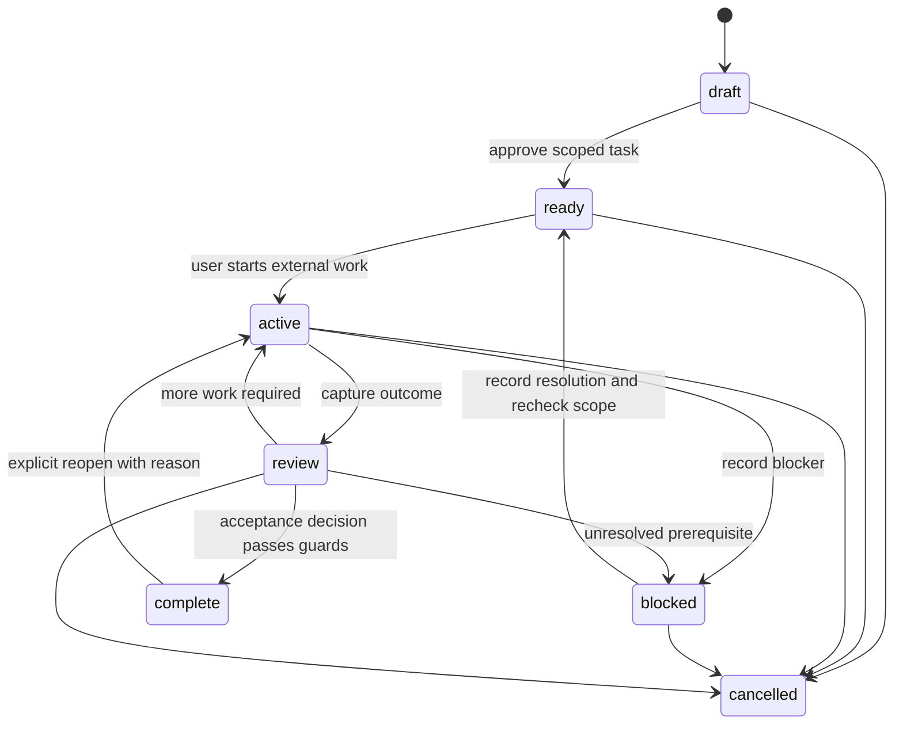

# Shared state and session contract

Status: proposed version-1 format, 2026-09-22. Examples are illustrative, not implemented schemas. The current planning repository uses ordinary human-authored Markdown; adopting this format later requires a reviewed migration.

## Source of truth

**Shared Markdown is authoritative for project knowledge, accepted tasks and accepted handoffs.** The application parses it into an in-memory projection. Private JSON caches are disposable indexes identified by source hashes; they never win a conflict with Markdown. The private store is authoritative only for private drafts, local sessions, attachments, endpoint settings and application-observation receipts.

The same fact has one authoritative home. Other documents may include a clearly dated snapshot or a reference, not an independently editable competing field.

| File | Authoritative responsibility | What it must not become |
| --- | --- | --- |
| `project.md` | Workspace identity, purpose, users, scope, constraints, requirements, decisions and unknowns. | A transcript or file inventory. |
| `codebase.md` | Structure, commands and conventions with source attribution; proposed structure stays separate. | An unqualified assertion that proposed code exists or reported tests ran. |
| `plan.md` | Task definitions, stable IDs, dependency edges, acceptance criteria, lifecycle state, completion decision and evidence references. | A second detailed execution history. |
| `progress.md` | Dated milestone/current focus and links to tasks/handoffs, with snapshot source digest. | Authoritative task status or one person's private running log. |
| `handoffs/<task-id>.md` | Task execution checkpoints, evidence summaries, blockers, omissions, relevant files and next action. | A second editable task definition or global shared chat. |
| `AGENTS.md` | Explicit instructions for reading/reconciling context and proposing maintenance. | Application permissions or a universal promise of agent autodiscovery. |

Existing filenames may collide with unrelated documents. On open, show discovered documents and let the user adopt selected files through a reviewed insertion of structured sections, or map the full context set into a dedicated project subdirectory. Store that relative context-root mapping in a small visible, reviewed marker in the adopted `AGENTS.md`; if the instruction file cannot be changed, the user selects the context directory on each new clone and the next-session prompt carries explicit paths. Do not replace an existing instruction file. V1 supports one context set per opened workspace; nested projects need separate opens.

## Editable Markdown format

Use readable Markdown prose plus small, application-marked fenced JSON blocks for fields requiring exact parsing. Prefer JSON to YAML for v1 to avoid implicit typing, executable tags, aliases, and a second object deserializer. The cost is punctuation in fields edited by hand; provide forms as an easier editor. Do not parse task state from loose prose or a free-form Markdown table.

Recognize a block only when immediately preceded by an exact marker such as `<!-- vibecoder:task v1 -->`, outside other code fences. Each marked block carries one entity. Scan Markdown syntax/source spans, not a regex over the entire document. Do not permit nested blocks, duplicate IDs, duplicate JSON object keys, unknown reserved fields, executable schema definitions, or unbounded arrays. Preserve unrelated prose, unknown ordinary fenced examples, line endings and unchanged bytes. Unsupported schema versions are view-only until a reviewed migration is available.

Illustrative task block in `plan.md`:

````markdown
## One smoke test

<!-- vibecoder:task v1 -->
```json
{
  "id": "T-7f2c9a10b843",
  "kind": "implementation",
  "objective": "Add one authenticated smoke test for the agreed journey",
  "state": "draft",
  "dependsOn": ["T-6ba02e19c4d8"],
  "scope": ["One journey in the approved non-production environment"],
  "outOfScope": ["Full regression coverage", "CI provisioning"],
  "stopConditions": ["Approved test access is unavailable", "The journey requires production data"],
  "acceptance": [
    {
      "id": "AC-1",
      "text": "The selected journey has a meaningful success assertion",
      "method": "User reviews the agent diff and an externally run test result",
      "evidenceRefs": [],
      "disposition": "pending"
    }
  ],
  "unknownRefs": ["U-auth"],
  "handoffPath": "handoffs/T-7f2c9a10b843.md",
  "completion": null
}
```

Additional notes can be ordinary Markdown below the block.
````

The structured objective and criteria above are the canonical values; do not repeat editable versions in adjacent prose. A heading is a display label. Current planning IDs `VC-001` etc. are stable human-chosen IDs; production-created task IDs use `T-` plus 12 random hexadecimal characters, validated for uniqueness in the workspace. IDs never derive from row order or branch names. Imported IDs are preserved when valid and unique. Local collision checks and post-merge validation catch the unlikely random collision. Task removal is cancellation, preserving links; accidental duplicate IDs block projection until the user resolves them.

## Data model

All persisted structured records have a schema version. Timestamps use ISO 8601 UTC. Paths in shared documents are relative to the granted workspace; absolute paths and credential/profile details stay private. Null or `unknown` is distinct from false, empty or not applicable. Actor names are user-provided labels, not authenticated identities.

| Entity | Essential fields | Authority/location |
| --- | --- | --- |
| Project | Stable workspace UUID, title, context-root mapping; prose for purpose/users/scope/constraints. | `project.md`; local path association is private. |
| Decision / unknown | ID, statement/question, status (`proposed/accepted/superseded` or `open/resolved`), rationale, source, affected task IDs, resolution and superseded reference. | Marked blocks in `project.md`. Decisions require explicit acceptance; unknowns never resolve by omission. |
| Task | ID, kind (`investigation/implementation/debugging`), objective, scope/exclusions, stop conditions, dependencies, acceptance criteria, unknown refs, state, handoff ref, completion decision. | Marked blocks in `plan.md`. |
| Repository snapshot | Git availability/status, observed timestamp, branch or detached marker, HEAD or unborn marker, selected changed paths and diff digest, coverage/truncation, source hashes. | Full local observation private; sanitized snapshot in handoff. |
| Outcome | ID, task/checkpoint ID, reporting actor/type, report time, completed actions, affected files, implementation claim, verification refs, blockers. | Accepted summaries in handoff; raw pasted report private. |
| Verification evidence | ID, claim checked, method/command, result, performer, provenance, timestamps, environment, commit/working-tree digest if known, artifact refs, limitations. | Accepted summary in handoff; private originals optional. |
| Attachment | Random ID, bounded media type, size, SHA-256, original local source, description, sensitivity, retention, availability. | Private local storage by default; optional explicit shared export. |
| Handoff checkpoint | ID, task ID, objective snapshot/digest, repo snapshot, actions, evidence, omissions, blockers, files, next action, creator/time, source document digests. | `handoffs/<task-id>.md`. |
| Session | Local ID, workspace-instance ID, selected task, stage, questions/answers, context snapshots, inference attempts, raw responses and user edits. | Private JSON records. |
| Proposal | ID/type, base document hashes, source revisions, typed changes, evidence refs, generated diff, status, approvals, final bytes/digests. | Private until accepted into shared documents. |
| Send receipt | Local request ID, profile reference, approved context digest, prompt version, usage, cost estimate, outcome/error category. | Private; operational logs omit content. |

A workspace UUID travels with a Git clone. A separate private instance ID is bound to the canonical folder/worktree, so opening two clones does not merge private state or inherit permissions. Shared evidence references remain useful through their summaries even if a teammate has no underlying private artifact. The UI must say “attachment unavailable locally” rather than inventing it or treating it as deleted proof.

## Lifecycle and evidence semantics

Task state is a workflow position. Implementation and verification are separate evidence attributes.



| Transition | Deterministic guard |
| --- | --- |
| `draft → ready` | Objective, bounded scope, exclusions, stop condition and measurable criteria exist; dependencies are acyclic and accepted as satisfied; no unresolved blocking unknown for this scope. |
| `ready → active` | User indicates they started; copying a prompt alone does not start work. Recheck dependent tasks and current repository scope. |
| `active → review` | Outcome recorded, each expected check has an evidence entry or an explicit not-performed reason, and next action is present. Implementation claim may still be incomplete. |
| `active/review → blocked` | Named blocker, affected criterion, what was attempted, and a concrete unblock action are recorded. |
| `blocked → ready` | Record the resolution and reassess stale evidence/scope. Partial implementation is retained. |
| `review → complete` | User reviews the result; every criterion has a satisfied or explicitly waived disposition, supporting evidence or waiver rationale; dependencies are satisfied, no unresolved blocker remains, knowledge/handoff updates are reconciled, and a completion decision is saved. |
| `complete → active` | Explicit reason and fresh scope/repository snapshot; old evidence remains historical and may be stale. |
| Any allowed state → `cancelled` | User provides reason; dependent tasks become not-ready until replanned. Cancellation does not satisfy a dependency. |

An investigation task can complete with documented findings and a scoped next task, without claiming implementation. `complete` is the user's acceptance decision, not independent certification by the app. Show “Complete — accepted with reported evidence” or “Complete — accepted with waived checks” as appropriate. Required checks can be waived only explicitly, with rationale and retained risk; a stricter project policy may disallow waiver. Do not display a generic “verified” badge on a whole task.

Use these distinct labels in outcome/evidence views:

- **Implemented — reported by user/agent:** a claim that changes were made, possibly supported by a diff. A diff establishes changed bytes, not behavioral correctness.
- **Reported as tested:** the user or external agent says a command/check ran; record exact method, outcome and available artifacts.
- **Verified by app — [specific observation]:** only a deterministic app observation, such as “file exists,” “HEAD matches,” “document schema valid,” or “artifact hash matches.” V1 does not execute project tests.
- **Reviewed by user:** a human examined a specific artifact/criterion and accepted it. The app records that action without upgrading it to an app-run test.
- **Complete:** the guarded acceptance decision above, retaining provenance and omitted/waived checks.

An external Markdown edit may claim `app_observed`. On this machine, show it as an imported assertion unless a matching local observation receipt or a fresh deterministic check supports it. Content hashes establish identity, not authenticity. A teammate's cloned handoff never silently gains local verification status.

Changing relevant files, HEAD, acceptance criteria or environment marks affected evidence potentially stale; it does not erase the historical result. With incomplete coverage, mark freshness unknown. Completion previously accepted on an older revision remains historical; reopening or a new dependent task requires explicit review of relevance.

## Review and synchronization protocol

1. **Read and index.** Read bounded context files, retain original bytes and hashes, parse marked blocks and references, and build a projection. On missing files, merge markers, invalid schema, duplicate IDs or broken dependency edges, show diagnostics. Retain the last valid projection only as visibly stale, read-only context. Never restore it over current files.
2. **Draft privately.** Model proposals and form edits create a private proposal. Each change references document hash, entity/section ID and evidence. No shared file changes while generation is running. The application renders final Markdown and computes diffs; a model cannot choose arbitrary filesystem paths or submit shell patches.
3. **Review.** Show exact before/after text and affected state transitions, sources, omissions and snapshot staleness. The user may edit, accept or reject individual changes. Revalidate the entire selected set: accepting a task status without its required evidence update is rejected or kept as an incomplete private draft.
4. **Recheck.** Immediately before application, acquire the workspace writer lock and reread all base files and relevant Git snapshot. Compare hashes/file identities, not just modification times. An external change invalidates approval. Show base/current/proposed text and require a freshly reviewed merge; do not use silent last-write-wins or automatic model conflict resolution.
5. **Apply safely.** Persist a private recovery journal with before/after bytes, expected hashes and target list. Stage only granted document paths. Preserve file access controls and encoding. Write/flush and replace one file at a time using the supported Windows safe-write procedure; reread and verify each resulting digest. Record completed targets, then mark the batch complete and rebuild the projection. Bound backup size and restrict private access.
6. **Recover explicitly.** On a crash or partial failure, show the interrupted batch before new writes. Offer complete or restore only for targets still matching the journal's expected before/after hashes. Any divergent file requires manual reconciliation. Do not advertise multi-file atomicity or overwrite external edits during rollback. Never export recovery material to Git.

A watcher is an invalidation hint; reread on focus, before generation, before apply, and before handoff export. Branch switches invalidate proposals and the selected-task projection. If a task does not exist on the new branch, retain the old private draft under its original branch context and ask the user to choose a task. Do not resurrect old-branch Markdown into the new branch.

**Filesystem limitation and release gate:** a hash check followed by replacement alone has a race with external writers. The Windows spike must qualify file-sharing/locking and replacement semantics, link checks, restrictive directory permissions, and conflict recovery under editor/antivirus interference. The product guarantees no silent overwrite of detected changes; it must also preserve recovery versions and disclose that arbitrary concurrent external writers cannot participate in an app transaction. During Apply, the UI asks users to pause external edits. If safe behavior cannot be demonstrated for supported local NTFS folders, keep the application in preview/export-only mode until fixed; do not ship an unsafe write path. Network and synchronized filesystems are not covered by this guarantee.

Externally edited valid Markdown is authoritative but not automatically trusted as a verified event. Import it as a new source revision, run validation, and require reconciliation before the next state-changing action. Render malformed content as editable text with diagnostics. Repair and schema migration are explicit diff proposals with a backup; unknown ordinary prose is preserved.

Undo is a new inverse proposal checked against current hashes, not a destructive reset. Exporting a handoff containing unsaved changes must say “draft” and is not allowed to present itself as the accepted current handoff.

## Task handoff contract

`handoffs/<task-id>.md` contains a current checkpoint and a small append-only sequence of earlier checkpoint summaries. Rich raw logs remain private. A new checkpoint supersedes the current pointer while preserving relevant evidence/history. Separate Git branches naturally carry different versions of the same task handoff. For simultaneous independent contributor work, use separate task IDs (and dependency edges); do not put competing owners' execution states into `progress.md`.

Every accepted checkpoint contains:

| Field | Requirement |
| --- | --- |
| Identity | Schema version, task/checkpoint ID, objective snapshot, canonical task digest, creator label, UTC timestamp. |
| Repository | `none/unavailable/present`, branch or detached/unborn marker, last observed commit, observation time and scope. Null values have reasons. |
| Uncommitted work | Relevant staged/unstaged/untracked paths, selected diff digest or summary, source/provenance, truncation and intentionally uninspected files. A digest is not a backup patch. |
| Actions | Completed actions, implementation claims, affected files and what remains. |
| Verification | Criterion-linked method/command, result, performer/provenance, environment, tested commit/working-tree state, evidence references, freshness and limitations. |
| Omissions | Checks not performed and reasons; explicitly recorded waivers, if any. |
| Open items | Blockers, unresolved decisions, hypotheses separated from observed evidence. |
| Context | Relevant relative files and sections, selected instruction-file paths, hashes of source documents, availability of private artifacts. |
| Next action | One precise scoped action, prerequisites and stop conditions; no vague “continue implementation.” |

**Prepare handoff:** collect fields from the task and accepted outcomes, optionally use an LLM to draft prose, validate completeness, preview the diff, and let the user apply it. Missing Git does not prevent preparation. Unknown commits and uninspected changes are explicit.

**Copy next-session prompt:** deterministic rendering from an accepted checkpoint and current observed state. First recheck context and Git metadata; if changed, show mismatch and require reconciliation or an explicitly labeled stale-context prompt. Prompt copying needs no inference call. Clipboard transfer cannot prove the coding agent received or acted on the text.

Template:

```text
Resume task <task-id>: <objective snapshot>.

Read <instruction paths>, <context-root>/project.md, codebase.md,
plan.md, progress.md, and handoffs/<task-id>.md. Read only the relevant
referenced files needed for this scope. Do not assume these instructions
were auto-discovered.

Before changing anything, inspect the current folder and, if Git exists,
the branch, HEAD, staged/unstaged changes and relevant untracked files.
The handoff last observed <branch/commit/time or explicit no-Git state>.
Compare actual repository evidence with the documents and report material
contradictions. Do not overwrite unrelated work or trust a stale handoff
over current repository evidence. Separate observed facts from reports.

Objective and acceptance criteria: <canonical task references and text>.
Scope/exclusions: <bounded scope>. Blockers/unknowns: <explicit list>.
Next action: <one precise action>. Stop if <conditions>.

When finished or blocked, report actions, relevant files/diff summary,
verification commands and results, environment and tested revision if
known, checks not performed, blockers, and the next action. Do not claim
tests passed without running them. Return proposed project-document
updates for review; do not mark this task complete or edit the shared
knowledge files as part of this prompt. Code changes and command execution
remain subject to my coding-agent permissions and this task's scope.
```

An investigation prompt adds “investigate and report; do not implement.” An implementation prompt includes a reviewed decision basis. Both include an expected return format with the handoff fields. A teammate without the application can read these Markdown files and use the prompt; the workflow is not locked to the app.

## Debugging packet

Required packet sections: task/objective; expected behavior; actual behavior; minimal reproduction steps and frequency; environment with versions where known; recent relevant changes; selected logs/screenshots with provenance; attempted fixes and each outcome; hypothesis; unresolved questions; one next investigation. Mark missing fields unknown and identify which are blocking a useful diagnosis.

Evidence items state source and time. Hypotheses have their own heading and never enter the evidence list as facts. Attaching a screenshot does not mean the app interpreted it. Include the user's description and a local reference; the export preview identifies which files need manual attachment. MVP creates Markdown text plus separately selected attachment files, not a remote link or automatic upload. Shared export is optional, with a sanitized-copy preview and explicit destination grant. Do not silently publish original private logs or screenshots into the repository.
